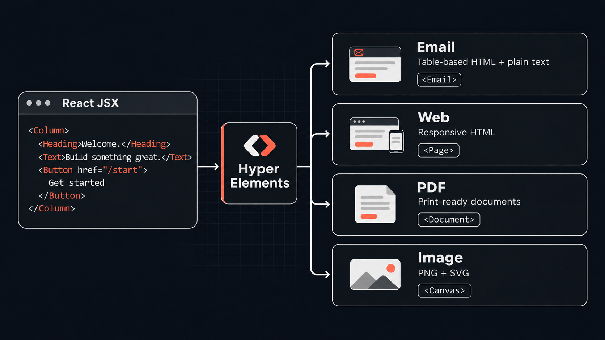
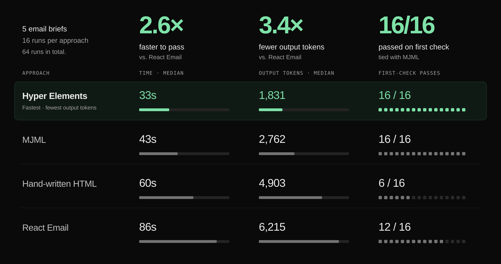
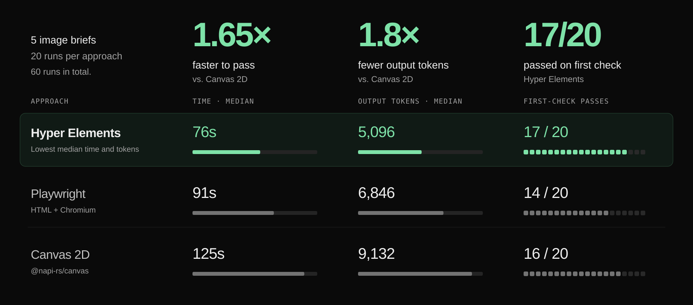

<p align="center">
  
</p>

<h1 align="center">Hyper Elements</h1>

<p align="center">
  <strong>Build emails, web pages, PDFs, and images with React.</strong><br />
  One component system for developers and AI agents.
</p>

<p align="center">
  <a href="https://www.npmjs.com/package/@hyper-elements/react"></a>
  <a href="https://www.npmjs.com/package/@hyper-elements/react"></a>
  <a href="https://github.com/hyper-elements/hyper-elements/actions/workflows/test.yml"></a>
  <a href="https://codecov.io/gh/hyper-elements/hyper-elements"></a>
  <a href="./LICENSE"></a>
</p>

<p align="center">
  <a href="#quick-start">Quick start</a> ·
  <a href="#build-with-ai-agents">AI agents</a> ·
  <a href="https://hyperelements.dev/templates">Templates</a> ·
  <a href="https://hyperelements.dev/docs">Documentation</a> ·
  <a href="https://hyperelements.dev">Website</a>
</p>

Hyper Elements is an open-source React library for generating content. Write a receipt, invoice, landing page, or social card with typed components. The engine handles layout and the markup each output needs, including email tables and responsive web HTML.

- **Reuse your work across formats.** Share content, styles, and components between an email, its web version, and a PDF.
- **Build real web pages.** On a Page, `Box` and typed CSS styles (flex, grid, position, gradients, shadows) lay out any structure, while the same components still write email-safe HTML.
- **Keep every output on brand.** Define colors, fonts, sizes, and component styles once in a theme, and every email, page, PDF, and image that uses it follows.
- **Give agents useful feedback.** Validate templates, inspect layouts as text, and get diagnostics that explain where a problem is and how to fix it.
- **Render in your own app.** Generate output on your server, with no browser, hosted service, or API key required.

<p align="center">
  
</p>

## Quick start

In a React project (React 18 or later):

```bash
npm install @hyper-elements/react react react-dom
```

Build an order update, then render the same content as an email and a web page:

```tsx
import {
  Button, Column, Email, Heading, Page, Text, render,
} from "@hyper-elements/react";

function OrderUpdate({ name }: { name: string }) {
  return (
    <Column style={{ padding: 32, gap: 16 }}>
      <Heading level={1}>Thanks, {name}.</Heading>
      <Text>Your order is on its way.</Text>
      <Button
        href="https://example.com/orders/10482"
        style={{ backgroundColor: "#ef4638", color: "#ffffff" }}
      >
        Track your order
      </Button>
    </Column>
  );
}

const content = <OrderUpdate name="Ada" />;
const { html, text } = await render(<Email width={600}>{content}</Email>);
const { html: pageHtml } = await render(<Page width={960}>{content}</Page>);
```

`html` and `text` are the email's HTML and plain text, ready for your [email provider](https://hyperelements.dev/docs/guides/sending). `pageHtml` is a complete responsive web document. No client-side JavaScript is required.

## Choose your output

Use the same layout and content components under the root for your destination:

| Build | Root | Render to |
| --- | --- | --- |
| Receipts, newsletters, transactional emails | `<Email>` | Email HTML and plain text with `render()` |
| Landing pages, web versions of emails | `<Page>` | Responsive HTML with `render()` |
| Invoices, reports, printable documents | `<Document>` | Print HTML with `render()`, or a PDF with [`renderPdf()`](./packages/react/docs/render-pdf.md) |
| Social cards, Open Graph images, banners | `<Canvas>` | PNG or SVG with [`renderImage()`](./packages/react/docs/render-image.md) |

The PDF and image renderers use separate imports and optional dependencies in Node.js. Diagnostics flag features a destination cannot represent. See [one invoice rendered as email, web, and PDF](./examples/content-workflows) for a complete example.

## Build with AI agents

Give Claude Code, Codex, Cursor, or another coding agent the guide:

```bash
npx skills add hyper-elements/hyper-elements
```

Or add this to your project's `AGENTS.md` or agent rules:

```text
Before writing a Hyper Elements template, read
node_modules/@hyper-elements/react/GUIDE.md.
Validate the template, fix errors, review warnings, and inspect outline() before rendering.
```

The package includes `GUIDE.md` and `REFERENCE.md`, generated from its component definitions so they match the version you installed. Web-based agents can use [llms.txt](https://hyperelements.dev/llms.txt) or [llms-full.txt](https://hyperelements.dev/llms-full.txt).

### A feedback loop the agent can read

`validate()` returns diagnostics with a code, severity, template path, and an actionable message. `outline()` shows the layout without making the agent read generated HTML. Try both on the quick-start component:

```tsx
import { outline, validate } from "@hyper-elements/react";

const template = <Email width={600}><OrderUpdate name="Ada" /></Email>;
const report = validate(template);

console.log(report.diagnostics);
if (report.valid) console.log(outline(template));
```

```text
Email 600px
  Column 600px
    Heading h1 536px "Thanks, Ada."
    Text 536px "Your order is on its way."
    Button: background #ef4638 "Track your order" → https://example.com/orders/10482
```

An agent can spot missing content, incorrect widths, and layout mistakes before rendering. Validation checks the engine's support rules; it does not open every email client. [Agent setup and examples →](https://hyperelements.dev/docs/guides/ai-agents)

## Agent Benchmarks

### Email

In our benchmark of five email briefs, Hyper Elements reached a passing email **2.6× faster** with **3.4× fewer output tokens** than React Email, at the median. It was also **1.3× faster than MJML**. Hyper Elements and MJML both passed **16 of 16** first checks.

<p align="center">
  <a href="https://hyperelements.dev/docs/benchmark">
    
  </a>
</p>

All four approaches ran in one interleaved batch, with 16 runs each against the same Chromium checks at desktop and mobile widths; all 64 eventually passed. Token counts here measure output tokens, not total usage or cost. [Methodology](https://hyperelements.dev/docs/benchmark) · [Reproduce the benchmark](./benchmark)

### Image

Across five image briefs, Hyper Elements reached a passing image **1.65× faster** with **1.8× fewer output tokens** than Canvas 2D (`@napi-rs/canvas`), at the median. **17 of 20** images passed on the first check.

<p align="center">
  <a href="https://hyperelements.dev/docs/benchmark#image-results">
    
  </a>
</p>

All 60 isolated runs passed the same text, font, image and layout checks: five briefs, four runs per brief per approach. The speed comparison with Playwright was inconclusive. [Methodology and results](https://hyperelements.dev/docs/benchmark#image-results) · [Reproduce the benchmark](./benchmark)

## Keep building

- **Start from a design:** [Templates](https://hyperelements.dev/templates) · [Component gallery](https://hyperelements.dev/components)
- **Learn the API:** [Writing guide](./packages/react/GUIDE.md) · [Full reference](./packages/react/REFERENCE.md)
- **Stay on brand:** [Themes](https://hyperelements.dev/docs/themes)
- **Build pages:** [Box and CSS layout](https://hyperelements.dev/docs/layout#box-css-layout-on-a-page) · [Page styles](https://hyperelements.dev/docs/styles#on-a-page)
- **Use it in your app:** [Next.js example](./examples/nextjs-app-router) · [Email providers](./packages/react/docs/email-providers.md)
- **Bring existing templates:** [Migrate from React Email](./packages/react/docs/migrate-from-react-email.md) · [Move from Unlayer Elements](./packages/react/docs/migrating-from-unlayer-elements.md)
- **Let teammates edit visually:** [Optional Unlayer editor integration](./packages/react/docs/visual-editing.md)

## Contributing

Contributions are welcome. Use the Node.js version in [`.nvmrc`](./.nvmrc) and pnpm 9.7 or later, then run `pnpm install`, `pnpm build`, and `pnpm test`. See [CONTRIBUTING.md](./CONTRIBUTING.md) for the development workflow.

## License

[MIT](./LICENSE). Built by the team behind [Unlayer](https://unlayer.com); works independently of the Unlayer platform.
