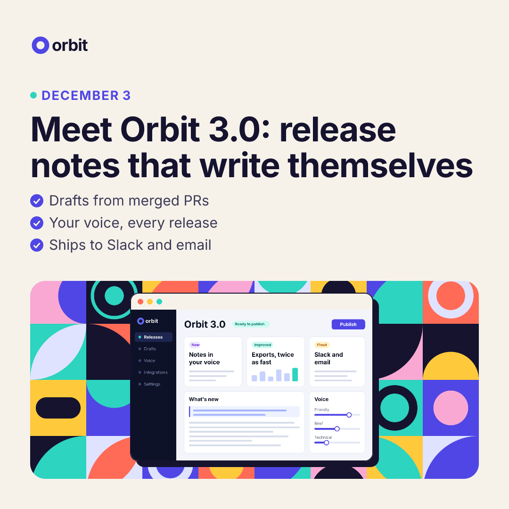
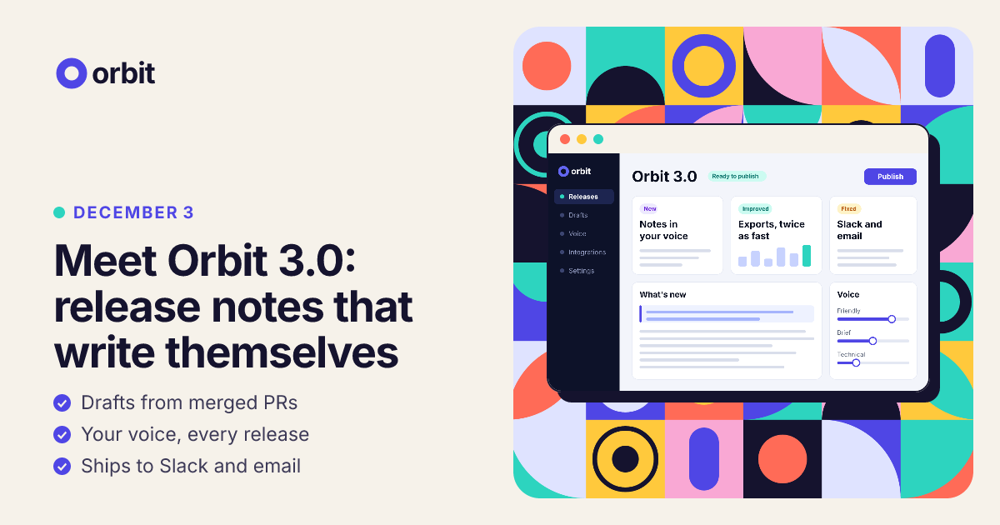
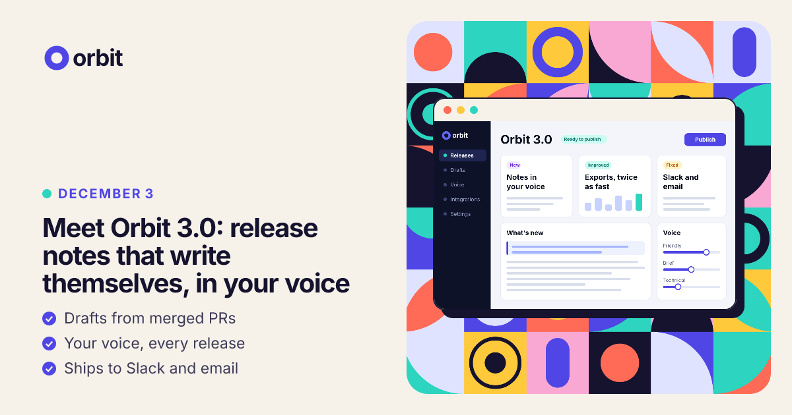

# Templates: reusable designs with guardrails

A template is how a team gets the output it wants, from people and from agents. It holds the parts of a design that
never change, opens typed fields for whoever fills it, and checks the result before anything is rendered. It's
`@hyper-elements/react/template`, and it runs wherever a design does: no service, account, engine or Node API.

A template has three kinds of parts:

- **Fixed parts:** everything in its `render` that no open part reaches. The logo, the header and footer, the fonts and
  colors, the layout per format and the legal text are the template's; nothing a value can say changes them.
- **Open parts**, where whoever fills it works:
  - **fields:** typed values, each with its rules: a headline of at most 90 characters, a date, exactly three
    features, an optional promo, a product screenshot at least 1600px wide and 1.2:1 to 2:1, shown whole;
  - **blocks:** approved section types, picked, ordered and filled as data;
  - **slots:** JSX the filler writes, with only the elements and brand styles the template allows.
- **Rules over the result:** checks on the finished design (an unsubscribe link, links only to the team's domains,
  root props), each failing with what to fix.

A **design** is one finished piece (this week's newsletter, the launch graphic for Orbit). A design made from a
template is the template used as the design's root, its props the values:

```tsx
// designs/launch.tsx
import Launch from "../templates/launch-graphic";

export default () => (
  <Launch
    format="square"
    headline="Meet Orbit: release notes that write themselves"
    features={["Drafts from merged PRs", "Your voice, every release", "Ships to Slack and email"]}
    launchDate="2026-12-03"
    screenshot={{ src: "./art/screenshot.png", width: 2400, height: 1500 }}
    artwork={{ src: "./art/shapes.png", width: 2160, height: 1360 }}
  />
);
```

`render()`, `validate()`, `outline()`, `prepare()`, `inspect()`, `renderPdf()` and `renderImage()` all hand that root to
the template: it reads the values, builds its design for the format and checks it, and the entry point goes on with
what the template built. A design the template refuses fails as any design with errors does (`render()` rejects with
an `ElementsError` listing the problems), and each result names the template: `template: { id, version }`.
TypeScript checks the props as they're written: a missing required field, a field the template doesn't have and a
number given for text are type errors.

## Writing a template

```tsx
import { Canvas, Column, Heading, Image, Layer, List, ListItem, Row, Text, prop } from "@hyper-elements/react";
import { field, fitInside, formatDate, template } from "@hyper-elements/react/template";

export default template({
  id: "acme.LaunchGraphic", // a namespace, a dot and a capitalized name
  version: "1.0.0", // semver: a values file records it
  label: "Product launch graphic",
  guidance: "For product launches only. Copy is in sentence case, with no emoji and no exclamation marks.",
  root: "Canvas",
  formats: {
    square: { width: 1080, height: 1080, scale: 2 },
    landscape: { width: 1200, height: 675, scale: 2 },
  },
  fields: {
    headline: prop.text({ label: "Headline", required: true, maxLength: 90 }),
    features: prop.list(prop.text({ label: "Feature", maxLength: 48 }), { label: "Features", required: true, min: 3, max: 3 }),
    launchDate: prop.date({ label: "Launch date", required: true }),
    locale: prop.choice(["en-US", "de-DE", "fr-FR"], { label: "Language", default: "en-US" }),
    screenshot: field.image({ label: "Product screenshot", required: true, fit: "contain", aspect: { min: 1.2, max: 2 }, minWidth: 1600, accepts: ["png"] }),
    artwork: field.image({
      label: "Decorative artwork",
      required: true,
      fit: "cover",
      maxCrop: 0.6,
      guidance: "Abstract light waves in violet and teal on dark navy. No text, letters, logos, UI or people.",
    }),
  },
  example: {
    headline: "Meet Orbit: release notes that write themselves",
    features: ["Drafts from merged PRs", "Your voice, every release", "Ships to Slack and email"],
    launchDate: "2026-12-03",
    screenshot: { src: "./example/screenshot.png", width: 2400, height: 1500 },
    artwork: { src: "./example/waves.png", width: 2160, height: 1360 },
  },
  render(v, { format }) {
    const square = format === "square";
    const region = square ? { width: 952, height: 400 } : { width: 488, height: 547 };
    const words = (
      <Column style={{ gap: 24 }}>
        <Heading field="headline" level={1} style={{ fontSize: square ? 76 : 56 }}>{v.headline}</Heading>
        <List>{v.features.map((feature, i) => <ListItem key={i} field={`features[${i}]`}>{feature}</ListItem>)}</List>
        <Text field="launchDate">{formatDate(v.launchDate, v.locale, { month: "long", day: "numeric" })}</Text>
      </Column>
    );
    const art = (
      <Layer style={{ ...region, alignItems: "center", justifyItems: "center" }}>
        <Image field="artwork" src={v.artwork} alt="" />
        <Image field="screenshot" src={v.screenshot} alt="Orbit" style={fitInside(v.screenshot, { width: region.width - 92, height: region.height - 60 })} />
      </Layer>
    );
    return (
      <Canvas {...(square ? { width: 1080, height: 1080 } : { width: 1200, height: 675 })} lang={v.locale} style={{ padding: 64, gap: 32 }}>
        {square ? <>{words}{art}</> : <Row style={{ gap: 64 }}>{words}{art}</Row>}
      </Canvas>
    );
  },
});
```

- **Fields** are the main entry's `prop` helpers: `prop.text({ maxLength, pattern })` (a regular expression's
  source, matched with the `u` flag), `prop.date()` (`YYYY-MM-DD`), `prop.list(item, { min, max })`,
  `prop.object(fields)`, `prop.choice()`, `prop.number()`, `prop.link()` and the rest. A field is required only with
  `required: true`; a list not given is `[]` (its `min` applies to that too), an optional object is `undefined`, and a
  `default` is filled in. Lists and objects compose: a `field.image()` inside a list of objects keeps its rules, at
  `stories[1].image`.
- **`field.image()`** takes `{ src, width, height }`, the file's size in px, and the rules a template checks:
  `fit` (`"contain"`, shown whole; `"cover"`, cropped from the center to fill its region), `aspect: { min, max }`,
  `minWidth`, `minHeight`, `accepts` (`png`, `jpeg`, `gif`, `svg`, `webp`), `transparent` and `maxCrop`.
- **`field="…"`** on a built-in says which field it shows (`headline`, `features[1]`, `stories[1].image`). It's how the
  template's checks find each image where it's drawn, and a diagnostic on a bound node names its `field`. A binding
  inside a custom element's own render is left out (`field/dropped`).
- **`guidance`**, on a field or the template, is plain English for whoever fills it: never enforced, listed by
  `describe()` and returned by `check()` as `review` items for a person to judge.
- **`formats`** are a template's named sizes: a Canvas's `{ width, height, scale }`, a Document's `{ size,
  orientation }`. `render` gets the format's name and arranges the design for it.
- **`example`** is required: `describe()` lays it out, and tests render it in each format.
- A field can't be named `format`, `key`, `ref` or `children` (`template/field-name`): they're props of the
  template's component.

## A full example: a launch graphic

A template for a product's launch graphic in two formats, start to finish: the template, a design made from it, its
check, and what's drawn. Everything shown here is what the commands wrote. The project:

```text
templates/launch-graphic.tsx       the template
templates/assets/orbit-logo.png    its logo: the template's own
fonts/Inter-Regular.ttf            the brand's fonts
fonts/Inter-Bold.ttf
designs/art/screenshot.png         a launch's pictures
designs/art/shapes.png
brief.json                         a launch's copy
package.json                       "hyperElements": { "templates": ["templates/**"] }
```

### The template

The layout of each format, the colors, the fonts and the logo are the template's. A launch gives six values: a
headline, exactly three features, a date, a language, a product screenshot and a piece of artwork. The headline is
fitted: drawn at the largest of its sizes that takes three lines or fewer, and what's under it follows it. The
artwork fills a panel, and the screenshot is shown whole in a window over it.

```tsx
// templates/launch-graphic.tsx
import { Canvas, Circle, Column, Heading, Image, Layer, Path, Rect, Row, Svg, Text, prop } from "@hyper-elements/react";
import { field, fitInside, formatDate, template } from "@hyper-elements/react/template";

// The brand's fonts and colors.
const FONTS = [
  { family: "Inter", src: "../fonts/Inter-Regular.ttf", weight: 400 },
  { family: "Inter", src: "../fonts/Inter-Bold.ttf", weight: 700 },
];
const [INK, PAPER, INDIGO, TEAL] = ["#15132e", "#f6f2ea", "#4f46e5", "#2dd4bf"];

// Each format's layout. It's the template's: no value changes it.
const LAYOUT = {
  square: { width: 1080, height: 1080, words: 952, headline: [72, 64, 56], text: 30, art: { width: 952, height: 420 }, shot: { width: 512, height: 320 } },
  landscape: { width: 1200, height: 630, words: 504, headline: [52, 46, 40], text: 23, art: { width: 552, height: 566 }, shot: { width: 456, height: 285 } },
} as const;

export default template({
  id: "acme.LaunchGraphic",
  version: "1.0.0",
  label: "Product launch graphic",
  guidance: "For product launches only. Sentence case, no emoji, no exclamation marks.",
  root: "Canvas",
  formats: { square: { width: 1080, height: 1080 }, landscape: { width: 1200, height: 630 } },
  fields: {
    headline: prop.text({ label: "Headline", required: true, maxLength: 90 }),
    features: prop.list(prop.text({ label: "Feature", maxLength: 40 }), { label: "Features", required: true, min: 3, max: 3 }),
    launchDate: prop.date({ label: "Launch date", required: true }),
    locale: prop.choice(["en-US", "de-DE"], { label: "Language", default: "en-US" }),
    screenshot: field.image({ label: "Product screenshot", required: true, fit: "contain", aspect: { min: 1.2, max: 2 }, minWidth: 1000, accepts: ["png"] }),
    artwork: field.image({ label: "Artwork", required: true, fit: "cover", maxCrop: 0.6, accepts: ["png"], guidance: "Bold flat shapes in the brand's colors. No text, logos or people." }),
  },
  // What only measuring decides has to hold: nothing past the Canvas, a font for every character, a headline that fits.
  rules: { require: { core: ["image/overflow", "image/glyph", "image/fit"] } },
  example: {
    headline: "Meet Orbit 3.0: release notes that write themselves",
    features: ["Drafts from merged PRs", "Your voice, every release", "Ships to Slack and email"],
    launchDate: "2026-12-03",
    screenshot: { src: "../designs/art/screenshot.png", width: 1600, height: 1000 },
    artwork: { src: "../designs/art/shapes.png", width: 1600, height: 1200 },
  },
  render(v, { format }) {
    const f = LAYOUT[format];
    const logo = <Image src={{ src: "./assets/orbit-logo.png", width: 252, height: 128 }} alt="Orbit" style={{ width: 126 }} />;
    const words = (
      <Column style={{ width: f.words, gap: 18 }}>
        {/* The date, written for the language, without its year. */}
        <Row style={{ gap: 10, alignItems: "center" }}>
          <Svg width={14} height={14}>
            <Circle cx={7} cy={7} r={7} style={{ fill: TEAL }} />
          </Svg>
          <Text field="launchDate" style={{ color: INDIGO, fontSize: f.text - 3, fontWeight: 700, lineHeight: 1.2, letterSpacing: 2, textTransform: "uppercase" }}>
            {formatDate(v.launchDate, v.locale, { month: "long", day: "numeric" })}
          </Text>
        </Row>
        {/* The headline is drawn at the largest size that fits it in three lines. What's under it follows it. */}
        <Heading field="headline" level={1} fit={{ sizes: [...f.headline], maxLines: 3 }} style={{ color: INK, lineHeight: 1.06, letterSpacing: -1.5 }}>
          {v.headline}
        </Heading>
        <Column style={{ gap: 8 }}>
          {v.features.map((feature, i) => (
            <Row key={i} style={{ gap: 12, alignItems: "center" }}>
              <Svg width={f.text - 2} height={f.text - 2} viewBox="0 0 24 24">
                <Circle cx={12} cy={12} r={12} style={{ fill: INDIGO }} />
                <Path d="M6.5 12.5 L10.5 16.5 L17.5 8.5" style={{ fill: "transparent", stroke: PAPER, strokeWidth: 2.6 }} />
              </Svg>
              <Text field={`features[${i}]`} style={{ color: "#3d3a57", fontSize: f.text, lineHeight: 1.3 }}>
                {feature}
              </Text>
            </Row>
          ))}
        </Column>
      </Column>
    );
    // The screenshot, shown whole in a window of the template's own, with the window's shadow behind it.
    const shot = fitInside(v.screenshot, f.shot);
    const [width, height] = [shot.width + 4, shot.height + 38];
    const product = (
      <Layer style={{ width: width + 12, height: height + 12, justifyItems: "start" }}>
        <Svg width={width + 12} height={height + 12}>
          <Rect x={12} y={12} width={width} height={height} rx={18} style={{ fill: INK }} />
        </Svg>
        <Column style={{ width, backgroundColor: PAPER, border: `2px solid ${INK}`, borderRadius: 18, overflow: "hidden" }}>
          <Row style={{ padding: [11, 14] }}>
            <Svg width={52} height={12}>
              <Circle cx={6} cy={6} r={6} style={{ fill: "#ff6b57" }} />
              <Circle cx={26} cy={6} r={6} style={{ fill: "#ffc93c" }} />
              <Circle cx={46} cy={6} r={6} style={{ fill: TEAL }} />
            </Svg>
          </Row>
          <Image field="screenshot" src={v.screenshot} alt="The product" style={shot} />
        </Column>
      </Layer>
    );
    // The artwork fills a panel, and the product sits in the middle of it.
    const art = (
      <Layer style={{ ...f.art, borderRadius: 32, alignItems: "center", justifyItems: "center" }}>
        <Image field="artwork" src={v.artwork} alt="" />
        {product}
      </Layer>
    );
    return (
      <Canvas width={f.width} height={f.height} fonts={FONTS} lang={v.locale} style={{ backgroundColor: PAPER, fontFamily: "Inter" }}>
        {format === "square" ? (
          // The logo at the top and the art at the bottom: the space around the words takes up the slack.
          <Column style={{ height: f.height, padding: 64, justifyContent: "space-between" }}>
            {logo}
            {words}
            {art}
          </Column>
        ) : (
          <Row style={{ height: f.height, padding: [32, 32, 32, 64], gap: 48 }}>
            <Column style={{ width: f.words, height: f.art.height, padding: [24, 0], justifyContent: "space-between" }}>
              {logo}
              {words}
            </Column>
            {art}
          </Row>
        )}
      </Canvas>
    );
  },
});
```

### A design made from it

`brief.json` holds the launch's copy:

```json
{
  "headline": "Meet Orbit 3.0: release notes that write themselves",
  "features": ["Drafts from merged PRs", "Your voice, every release", "Ships to Slack and email"],
  "launchDate": "2026-12-03"
}
```

`design new` makes the design from it, with each picture given as its file:

```bash
npx hyper-elements design new templates/launch-graphic.tsx -o designs/orbit.values.json --values brief.json --set screenshot=@designs/art/screenshot.png --set artwork=@designs/art/shapes.png
```

It writes `designs/orbit.values.json`: the template it's made from, the formats it's for, its values (each picture's
size read from its file, a default written out) and each file's hash. The template checked the values before the file
was written.

```json
{
  "version": 1,
  "template": { "module": "../templates/launch-graphic.tsx", "id": "acme.LaunchGraphic", "version": "1.0.0", "sha256": "9b2e4e91393b…" },
  "formats": ["square", "landscape"],
  "values": {
    "headline": "Meet Orbit 3.0: release notes that write themselves",
    "features": ["Drafts from merged PRs", "Your voice, every release", "Ships to Slack and email"],
    "launchDate": "2026-12-03",
    "locale": "en-US",
    "screenshot": {"src": "./art/screenshot.png", "width": 1200, "height": 750},
    "artwork": {"src": "./art/shapes.png", "width": 1080, "height": 680}
  },
  "assets": {
    "screenshot": {"sha256": "26796c37ec9b…"},
    "artwork": {"sha256": "20967b6fadce…"}
  }
}
```

### Checked, then drawn

```bash
npx hyper-elements check designs/orbit.values.json
```

```text
✓ designs/orbit.values.json [square] (Canvas)
  artwork (square): 952×420, needs 952×420px
  screenshot (square): 512×320, needs 512×320px
  fit headline: 72px (fits at 72, 64, 56)
  review artwork: Bold flat shapes in the brand's colors. No text, logos or people.
  review acme.LaunchGraphic: For product launches only. Sentence case, no emoji, no exclamation marks.
  review screenshot: Of unknown origin: no source is recorded for this image (give one with design set … --source)
  review artwork: Of unknown origin: no source is recorded for this image (give one with design set … --source)
✓ designs/orbit.values.json [landscape] (Canvas)
  artwork (landscape): 552×566, needs 552×566px
  screenshot (landscape): 456×285, needs 456×285px
  fit headline: 52px (fits at 52, 46, 40)
  review artwork: Bold flat shapes in the brand's colors. No text, logos or people.
  review acme.LaunchGraphic: For product launches only. Sentence case, no emoji, no exclamation marks.
  review screenshot: Of unknown origin: no source is recorded for this image (give one with design set … --source)
  review artwork: Of unknown origin: no source is recorded for this image (give one with design set … --source)
2 designs: 0 errors, 0 warnings, 0 skipped
```

Each format is checked on its own: the values, the design the template builds, and what only measuring it with its
fonts says. `fit headline` is the size the headline is drawn at; each picture's line is its region and the pixels it
needs at the scale it's rendered at; `review` lists what a person judges, which never fails a run.

```bash
npx hyper-elements render designs/orbit.values.json
```

```text
✓ designs/orbit.values.json [square] (Canvas) → out/designs/orbit.square.png
✓ designs/orbit.values.json [landscape] (Canvas) → out/designs/orbit.landscape.png
2 designs: 0 errors, 0 warnings, 0 skipped
```

| square, 1080×1080 | landscape, 1200×630 |
|---|---|
|  |  |

### A longer headline

Changing one value keeps the rest, and the template fits the new headline:

```bash
npx hyper-elements design set designs/orbit.values.json "headline=Meet Orbit 3.0: release notes that write themselves, in your voice"
```

The square format still takes it at 72px. The landscape format's headline is narrower: there it's drawn at 40px, not
52px, in the same three lines, with the date right above it and the features right under it.

| 51 characters, drawn at 52px | 66 characters, drawn at 40px |
|---|---|
|  |  |

### What it refuses

A banner in place of the screenshot is refused as it's set, and the file stays as it was:

```bash
npx hyper-elements design set designs/orbit.values.json screenshot=@designs/art/banner.png
```

```text
✗ designs/orbit.values.json: not written
    error template/asset-aspect at values.screenshot: Product screenshot is 1600×400, 4:1; it takes 2:1 or narrower
```

A headline inside its 90 characters that can't fit the landscape format's three lines, even at its smallest size, is
refused when the design is measured. `check` exits 1, and `render` writes nothing for a format that fails:

```bash
npx hyper-elements design set designs/orbit.values.json "headline=Meet Orbit 3.0: release notes that write themselves, in your own voice"
npx hyper-elements check designs/orbit.values.json
```

```text
✓ designs/orbit.values.json [square] (Canvas)
  artwork (square): 952×420, needs 952×420px
  screenshot (square): 512×320, needs 512×320px
  fit headline: 64px (fits at 64, 56)
  review artwork: Bold flat shapes in the brand's colors. No text, logos or people.
  review acme.LaunchGraphic: For product launches only. Sentence case, no emoji, no exclamation marks.
  review screenshot: Of unknown origin: no source is recorded for this image (give one with design set … --source)
  review artwork: Of unknown origin: no source is recorded for this image (give one with design set … --source)
✗ designs/orbit.values.json [landscape] (Canvas)
    error image/fit at root.children[0].children[0].children[1].children[1]: This Heading doesn't fit: it takes 4 lines at 40px, its smallest size, and fits 3: cut about 18 characters (required by acme.LaunchGraphic) Fix: Shorten the text, or give the template a smaller size
  rule image/fit (landscape): failed
  artwork (landscape): 552×566, needs 552×566px
  screenshot (landscape): 456×285, needs 456×285px
  fit headline: no size fits
  review artwork: Bold flat shapes in the brand's colors. No text, logos or people.
  review acme.LaunchGraphic: For product launches only. Sentence case, no emoji, no exclamation marks.
  review screenshot: Of unknown origin: no source is recorded for this image (give one with design set … --source)
  review artwork: Of unknown origin: no source is recorded for this image (give one with design set … --source)
2 designs: 1 error, 0 warnings, 0 skipped
```

## Slots

A slot is JSX the filler writes, inside limits the template sets. The template places it in a built-in bound to it,
its host, and everything under the host is the slot's:

```tsx
fields: {
  body: field.slot({
    label: "Body",
    required: true,
    allow: [Row, Column, Heading, Text, Image, Button, ProductCard], // the elements themselves
    styles: "theme", // every color, font, size and spacing a token()
    count: { Button: { min: 1, max: 2 } },
    guidance: "Lead with the news in one sentence.",
  }),
},
render: (v) => (
  <Email theme={brand}>
    <BrandHeader />
    <Section field="body">{v.body}</Section>
    <BrandFooter />
  </Email>
),
```

- **`allow`** lists the elements the content may use, given as the elements themselves. A built-in is allowed by its type, a
  custom element by its definition: content that defines its own `acme.ProductCard` is refused (`template/slot-element`,
  "not the template's"), and its render never runs. A root and `Html` are never allowed.
- **`allow: "all"`** allows every built-in the template's root may hold (what `describeElements({ root })` lists),
  but the roots and `Html`: a later Elements that adds one widens it. `deny: [Table, Video]` takes built-ins out of it,
  and `["all", ProductCard]` adds your own custom elements. A template that wants a fixed set across upgrades writes a list.
- **`styles`:** `"theme"` (the default) requires a `token()` for every brand value: each style and prop whose kind is a
  color, a font, insets or a radius, a border's color, and `fontSize`, `lineHeight`, `letterSpacing`, `gap` and
  `rowGap`, in `style`, `mobile` and `hover`. `"none"` takes only the theme's named styles (`apply`) and variants;
  `"free"` takes anything. Under `"none"` and `"theme"`, content can't set `tokens` or `theme` (`template/slot-tokens`).
  A literal where a token is required is `template/slot-style`.
- **`count`** limits each type, counting what's shown at some width (`template/slot-count`).
- Content never sets `attrs` (`template/slot-attrs`), and a `field` inside it is its own (`template/slot-field`).
- The content must be what its host may hold, as any children are: a Section's slot content starts with a Column, a
  Row or blocks, not another Section.
- **The template never sees the content.** Its render runs with a mark in the slot's place, so fixed parts can't depend
  on what's written there; the content is collected on its own (it sees none of the template's React context) and
  spliced in at the mark. The mark goes in exactly one node bound to the slot (`template/slot-host`).

A slot can be stored as data, in a values file: `{ "module": "./launch.body.tsx" }`, whose capture `check()` takes in
`fragments` (`template/slot-unloaded` without it), or `{ "fragment": … }`, the content captured with
`captureFragment()`, which `check()` reads itself. `toValuesFile()` stores a slot's JSX as its fragment.

## Blocks

`prop.blocks(types, { min, max })` is a list of approved section types, each a `prop.object()`. The filler picks which,
in what order, and fills them; the look is the template's:

```tsx
fields: {
  body: prop.blocks(
    {
      hero: prop.object({ title: prop.text({ label: "Title", required: true }), image: field.image({ label: "Image", fit: "contain" }) }, { label: "Hero" }),
      quote: prop.object({ text: prop.text({ label: "Quote", required: true, maxLength: 120 }) }, { label: "Quote" }),
    },
    { label: "Body", required: true, min: 1, max: 6 }
  ),
},
// values: { body: [{ type: "hero", title: "Orbit is live" }, { type: "quote", text: "Ship small." }] }
```

`type` names each block's type, so a block type can't have a field named `type` (`template/block-type`). An unknown or
missing type is `template/value`, naming the types. Rules and bindings inside a block work as anywhere:
`body[0].image`.

## Rules over the result

```tsx
import { lint } from "@hyper-elements/lint";

rules: {
  plugins: { lint: lint({ kind: "marketing" }) },
  require: {
    lint: ["unsubscribe", "preview-text", "contrast", "link-text", "lang"],
    core: ["layout/overflow"],
  },
  links: { domains: ["acme.com", "*.acme.com"], params: { utm_source: "newsletter" }, schemes: ["mailto"] },
  images: { domains: ["cdn.acme.com"] },
  root: { lang: true },
},
```

Each required rule ends `passed`, `failed` or `not-run`, in `check()`'s `rules`, and one that didn't run never counts
as passed.

- **`require.lint`** takes lint's rule ids. A finding of a required rule is an error, with "(required by …)". When the
  template is defined, a rule lint doesn't have, one that's off as lint is configured (`unsubscribe` needs
  `kind: "marketing"`), or one that doesn't run on the template's root (lint checks Emails and Pages) is
  `template/rule-unavailable`. If lint fails, its rules are `not-run`, an error (`template/rule-not-run`).
- **`require.core`** takes `layout/overflow`, `layout/shrunk`, `document/overflow`, `canvas/overflow`, and a Canvas's
  `image/overflow`, `image/glyph` and `image/fit`. Those last three are decided when the image is measured: `check()`
  leaves them `not-run`, and a writer given the snapshot refuses it (`template/rule-not-run`) until then.
- **`links`** checks every link the design writes, fixed parts and a Menu's included: an http(s) host not in `domains`
  (`acme.com` itself; `*.acme.com` its subdomains, not itself) is `template/link-domain`, a missing parameter
  `template/link-param`, another scheme not in `schemes` `template/link-scheme`, and a relative one
  `template/link-relative`. A URL with a sending service's tag (`{{…}}`) is listed for review, or refused with
  `tags: "deny"`; its host is checked all the same where it's written out (`https://evil.example/?id={{id}}` fails),
  and only a host that is itself a tag (`{{unsubscribe_url}}`) can't be.
- **`images`** checks every image the design loads, fixed parts, slots and a Social's icons included, when it's given:
  one from a host not in `images.domains`, a tag's host, inline data or a relative address is `template/image-domain`.
  A YouTube video with no thumbnail of its own shows YouTube's, from `img.youtube.com`.
- **`root`** requires root props (`template/root-prop`).
- `plugins.other` runs other plugins (email-clients'), whose findings are reported but can't be required.

## Annotated templates

A template with one size and fields of text, links, images and slots can be written as the design itself, with what's
open marked where it is:

```tsx
import { field, open, template } from "@hyper-elements/react/template";

const title = open(prop.text({ label: "Title", required: true, maxLength: 70 }));
const body = open(field.slot({ label: "Body", required: true, allow: "all", styles: "theme" }));

export default template({
  id: "acme.Newsletter",
  version: "1.0.0",
  rules: { plugins: { lint: lint({ kind: "marketing" }) }, require: { lint: ["unsubscribe"] } },
  open: { title, body },
  design: (
    <Email width={600} theme={brand}>
      <BrandHeader />
      <Heading field={title}>What's new at Acme</Heading>
      <Section field={body}>
        <Text>Three things shipped this week.</Text>
      </Section>
      <BrandFooter />
    </Email>
  ),
});
```

A marker goes on a built-in written in `design` itself: a text field on a Heading, Text, ListItem, Button or Link
holding its example text; a link on a Link's or Button's `href`; an image on an Image's `src`; a slot on the node that
holds its content. What each marked node holds is the example. A template with formats, lists, blocks or computed
values uses `fields` and `render`.

## Checking

`check(values, { format })` never throws. It returns `{ valid, values, diagnostics, review, rules, snapshots, template }`:

```ts
const checked = launch.check(brief);
if (!checked.valid) console.error(formatDiagnostics(checked.diagnostics));
const { image } = await renderImage(checked.snapshots.square!, { fonts, images });
```

It checks, in order:

1. **The values**, by their fields: a field the template doesn't have (`template/unknown-field`, naming the fields it
   has), a missing required one (`template/required`), a value its kind refuses (`template/value`), a list outside its
   counts (`template/count`), and each image's declared size against its rules (`template/asset-aspect`,
   `template/asset-pixels`, and `template/asset-type` from the file's extension). What only an image's file says
   (whether it's transparent, its type where its name doesn't give one) isn't decided here, and never counts as
   passed: it's a note, `template/asset-unread`, until `checkLayout()` is given the file.
2. **The design it builds in each format**, as `validate()` checks any design, and what only the template knows: its
   root and its format's size (`template/root`, `template/format`), its bindings (`template/unknown-binding` for a
   `field` that names no field; `template/unbound`, a warning, for an image with rules that nothing shows), and how
   each bound image is shown. A `contain` image shown at another aspect than its file's is `template/asset-distorted`;
   one that's a Layer's base, which is drawn as a cover, and a `cover` image cropped past `maxCrop`, are
   `template/asset-cropped`. These catch the template's own mistakes, not only bad values: size a `contain` image with
   `fitInside(image, box)`.

`snapshots` holds the design for each format checked (`default` for a template with one size), where it's valid, as a
**snapshot**: the design collected once and captured as inert data, which `render()`, `validate()`, `prepare()`,
`inspect()`, `renderPdf()` and `renderImage()` take in place of an element and never collect again. So what was
checked is what's rendered: slot content that would render something else the second time never gets a second time.
Rendering `design()`'s element instead runs a slot's code again, unchecked. `check(element)`, from the same entry, checks a design whose root is a template, in its `format` or, without
one, in every format.

## Measured rules and checkLayout()

What depends on fonts and files is measured, by the image entry, for a Canvas:

```ts
import { layoutImage, renderImage } from "@hyper-elements/react/image";
import { checkLayout, sniffImage } from "@hyper-elements/react/template";

const checked = launch.check(values, { format: "square" });
const layout = await layoutImage(checked.snapshots.square!, { fonts, images, scale: 2 });
const report = checkLayout(launch, checked.values, { format: "square", layout, files: { artwork: sniffImage(artworkBytes)! }, checked });
// report: { regions, fits, rules, diagnostics }
const { image } = await renderImage(checked.snapshots.square!, { fonts, images, scale: 2 });
```

- `checkLayout()` is synchronous and pure. It gives each bound image's region (its box, and the pixels it needs at the
  scale it's rendered), each fitted field's sizes, and checks each image's file: its size against the one declared
  (`template/asset-size`), its type and transparency against the rules (`template/asset-type`, `template/asset-alpha`),
  and whether it would be upscaled in its region (`template/asset-pixels`). An image's region is the template's own
  node bound to its field: a slot's content that names the field is never read as one.
- A file's rules aren't a Canvas's alone. For an Email, a Page or a Document there's no layout to measure, and
  `checkLayout(template, values, { layout: { nodes: [], fits: [], diagnostics: [] }, files })` checks each file given
  against its size, type and transparency.
- Given `check()`'s result, it decides the measured rules a template requires (`image/overflow`, `image/glyph`,
  `image/fit`), by format, and returns the complete `rules`.
- `renderImage()` of a template's snapshot, or of a template design, draws it `strict` and decides those rules itself:
  one that fails rejects, naming the rule. Any other writer refuses such a snapshot (`template/rule-not-run`).

## Designs as data

The same design can be data instead of TSX, for batches and tools: a values file, the template's reference and
version, the values, and each asset's hash and provenance beside them.

```ts
import { readValuesFile, toValuesFile } from "@hyper-elements/react/template";

const file = toValuesFile(launch, values, {
  module: "../templates/launch-graphic.tsx",
  formats: ["square", "landscape"],
  assets: { artwork: { sha256, source: { kind: "generated", provider, model, prompt } } },
});
const reopened = readValuesFile(JSON.parse(text), launch); // { values, formats, assets, diagnostics }
```

Defaults are written out, so a later minor release that changes one doesn't change the design. Reading checks the
template's id (`template/id`) and version: a newer minor or patch reads the values again with a `template/upgraded`
note, a newer major runs the template's `migrate[major](values)` for each major between (without one, it's
`template/version`), and a template older than the file's is `template/version`.

`update(values, patch)` changes some fields of checked values: what the patch doesn't name keeps its reference, an
object is merged (JSON Merge Patch: `null` removes a key), and a list is replaced whole. It throws an `ElementsError`
for a field the template doesn't have or a bad value. `design(values, { format })` returns the plain root element for
code that has values in hand.

## Discovering a template

`describe()` returns what whoever fills a template needs before starting, synchronously: its formats, every field (its
kind, whether it's required, its JSON Schema, its image rules and guidance), a JSON Schema of all its values, and for
each image the template shows, its region in each format (the box, and the pixels it needs at the format's scale).
For a `cover` image it adds the smallest size that fills every region without upscaling, and what each crops:

```json
{
  "path": "artwork",
  "kind": "image",
  "fit": "cover",
  "maxCrop": 0.6,
  "regions": { "square": { "box": [952, 400], "pixels": [1904, 800] }, "landscape": { "box": [488, 547], "pixels": [976, 1094] } },
  "suggested": { "width": 1904, "height": 1094, "crop": { "square": "cuts 27% of the height", "landscape": "cuts 49% of the width" } }
}
```

## Helpers

- `fitInside(image, box)`: the size that shows an image whole inside a box, at its own aspect.
- `sniffImage(bytes)`: an image file's `{ width, height, type, alpha }`, read from its header (PNG, JPEG, GIF, SVG), in
  plain JavaScript.
- `formatDate(date, locale, options)`: a date field written for a locale (`"3. Dezember"`, with `{ month: "long", day: "numeric" }`), in UTC, so the day is
  the one given and no clock is read.

## Keeping templates trusted

A template guarantees what it checks, not who may edit it: a process that can write the template's file can change
it. Commit templates and review changes to them (with CODEOWNERS, for example), and don't give whatever fills them
write access to the templates folder. A values file is data: nothing in it runs, so it's the form to take from an
agent or anyone unreviewed. A TSX design, and a slot stored as a module, are code that runs before the template
checks anything, and `--require-template` checks a design's content, not its code: review those as code.
